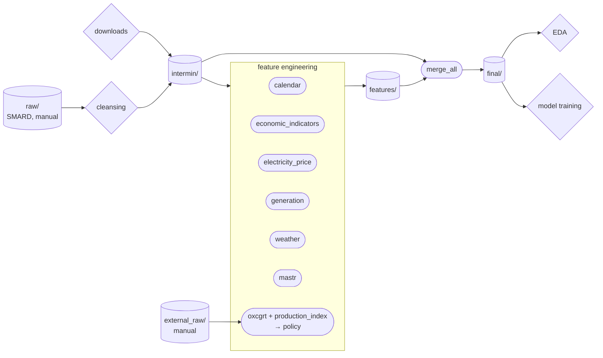

# Data and feature engineering

[README](../README.md) · [FEATURES](FEATURES.md) · **FEATURE_ENGINEERING** · [EDA](EDA.md) · [MODELS](MODELS.md)

## Navigator

- [Data and feature engineering](#data-and-feature-engineering)
  - [Navigator](#navigator)
  - [Data folders](#data-folders)
  - [Data flow (Diagram)](#data-flow-diagram)
  - [Scripts (downloads)](#scripts-downloads)
  - [Manual downloads](#manual-downloads)
  - [Feature engineering pipelines](#feature-engineering-pipelines)
  - [Adding a feature pipeline](#adding-a-feature-pipeline)

## Data folders

```
src/data/
├── raw/            # SMARD downloads, untouched
├── external_raw/   # manual or on-demand downloads for the policy features (not in git)
├── intermin/       # cleaned raw data and lookup tables (the folder name is spelled "intermin")
├── features/       # output of the feature pipelines, one sub-folder per feature group
│   ├── calendar/
│   ├── economic_indicators/
│   ├── electricity_price/
│   ├── generation/
│   ├── mastr/
│   ├── policy/
│   └── weather/
└── final/          # intermin + all features merged, the data for modelling
```

| Folder | File | Rows | Content |
|---|---|---|---|
| `raw/` | `Realisierter_Stromverbrauch_..._Tag.csv` | 2192 | SMARD daily export as downloaded (`;` separated, German number format) |
| `raw/` | `Realisierter_Stromverbrauch_..._Stunde.csv` | 52608 | SMARD hourly export as downloaded |
| `raw/` | `Realisierte_Erzeugung_201812230000_202501080000_Stunde.csv` | 52992 | SMARD hourly realised generation of 12 sources, manual download (see [Manual downloads](#manual-downloads)) |
| `intermin/` | `data_daily.csv` | 2192 | Renamed columns and parsed dates, standard CSV (`,` separated, `.` decimal) |
| `intermin/` | `data_hourly.csv` | 52608 | Same as above, hourly |
| `intermin/` | `population_by_land.csv` | 928 | Population of the 16 states per year (lookup table, no row index), used as weights |
| `intermin/` | `generation_by_source.csv` | 52992 | Hourly realised generation of the 12 sources in UTC, MWh (lookup table, no row index) |
| `intermin/` | `day_ahead_price.csv` | 52608 | Hourly day-ahead electricity price Germany / Luxembourg in UTC, EUR/MWh (lookup table, no row index) |
| `intermin/` | `gas_price_eu.csv` | 78 | European natural gas price per month, US dollars per MMBtu (lookup table, no row index) |
| `intermin/` | `school_holidays.csv` | 670 | School holiday periods of the 16 states (lookup table: one row per period, no row index) |
| `intermin/` | `mastr_solar.csv` | | Solar capacity commissioned per day (one row per commissioning date, lookup table, no row index), made by `src/scripts/mastr_etl.py` |
| `intermin/` | `weather_*_by_city.csv` | | Not committed to git (size, ~40 MB), made by `src/scripts/weather_etl.py`, see the scripts below |
| `features/<name>/` | `data_daily.csv` | 2192 | Daily output of the pipeline for that feature group |
| `features/<name>/` | `data_hourly.csv` | 52608 | Hourly output, only if the feature exists at hourly resolution |
| `final/` | `data_daily.csv`, `data_hourly.csv` | 2192 / 52608 | `intermin/` data + the columns of all features |

Notes:
- `raw/` is never edited. Everything else is produced by the scripts and pipelines and can be rebuilt from it.
- **The features are merged by `date_from_utc`**: the time in UTC (written without a time zone), made in `cleansing.py` and unique for every row. `date_from` and `date_to` (local time) stay in `intermin/` to read the data, they are not the key.
- Hourly `date_from` is naive local time (Europe/Berlin). SMARD has no 02:00 on the spring DST day and a duplicated 02:00 on the autumn one, so `date_from` can not be a key, `date_from_utc` can (the first 02:00 is summer time, the second one winter time).
- Every CSV in `intermin/` and `features/` still has the row index as an unnamed first column. Read with `pd.read_csv(path, index_col=0)`. It is not used to merge anymore.
- Notebooks in `src/notebooks/` only read the data, see [EDA](EDA.md).

## Data flow (Diagram)



Cylinders are folders, ellipses are the pipelines of the feature engineering and the merge, diamonds are the higher level steps. Every pipeline in the "feature engineering" box reads from `intermin/` (the policy step from `external_raw/`) and writes into its own folder in `features/`.

[main.py](../src/feature_engineering/main.py) runs cleansing, the feature groups and `merge_all`. For every feature group it looks at the feature files first:
- the files in `features/<group>/` exist and have `date_from_utc`: the group is skipped (nothing is downloaded or built). A file without `date_from_utc` is out of date and is built again,
- they do not exist, the downloaded files exist: only the pipeline runs,
- they do not exist, a downloaded file is missing: its download script runs first, then the pipeline.

So the downloads only run when there is no other way to get the feature files, a new machine that pulls the repo downloads nothing. `--rebuild` builds the features again, `--forceDownload` downloads again (and builds again). If a feature file is out of date (the code or the input changed), use `--rebuild`. A failed step stops the run. The policy step needs the manual files in `external_raw/`, so `main.py` only runs the last part of it ([policy_pipeline.py](../src/feature_engineering/policy_pipeline.py), see [below](#feature-engineering-pipelines)). EDA and model training are not part of `main.py`.

## Scripts (downloads)

One-off ETL scripts in [src/scripts/](../src/scripts/) download the data that does not come from the SMARD download center and save it in `intermin/`. Run them from the project root with `uv run python src/scripts/<name>.py`. Each script has its source, steps and run command in its docstring. They only need to run once (the data does not change).

| Script | Source | Writes | Note |
|---|---|---|---|
| [school_holidays_etl.py](../src/scripts/school_holidays_etl.py) | [ferien-api.de](https://ferien-api.de) (one request, all states and years) | `intermin/school_holidays.csv` | Re-running may hit HTTP 429 (rate limit). That is fine: the pipeline does not break and the data is already on GitHub. |
| [population_etl.py](../src/scripts/population_etl.py) | Destatis 12411LJ003 via [DBnomics](https://db.nomics.world) (one request) | `intermin/population_by_land.csv` | |
| [day_ahead_price_etl.py](../src/scripts/day_ahead_price_etl.py) | [SMARD](https://www.smard.de) (Bundesnetzagentur, CC BY 4.0), one request per week, about 2 minutes | `intermin/day_ahead_price.csv` | Uses the JSON files of the SMARD website charts, not a documented API, so it can change. SMARD gets the data from ENTSO-E. Cite as "Bundesnetzagentur \| SMARD.de". |
| [gas_price_etl.py](../src/scripts/gas_price_etl.py) | IMF PCPS `M.W00.PNGASEU.USD` via DBnomics (one request, no registration) | `intermin/gas_price_eu.csv` | DBnomics is a copy of the IMF data and some months behind (up to 2025-06), enough for our data. Cite as "IMF PCPS via DBnomics". |
| [weather_etl.py](../src/scripts/weather_etl.py) | [Open-Meteo](https://open-meteo.com) historical weather archive, 15 cities x 2 resolutions (30 requests, about 10 minutes) | `intermin/weather_daily_by_city.csv`, `intermin/weather_hourly_by_city.csv` | Not committed to git (`.gitignore`): `weather_hourly_by_city.csv` alone is ~40 MB. Re-run this script to regenerate it, the source data does not change. |
| [mastr_etl.py](../src/scripts/mastr_etl.py) | [Marktstammdatenregister](https://www.marktstammdatenregister.de) (MaStR, Bundesnetzagentur) bulk export, via the [`open-mastr`](https://github.com/OpenEnergyPlatform/open-MaStR) package (the full bulk export, one zip of about 3.2 GB, 20 - 60 minutes) | `intermin/mastr_solar.csv` | The capacity commissioned on each day (`commission_date`, `capacity_mw`, `n_units`), added up from the ~6.5 M units. Small (~200 KB), so it is committed and other machines do not need the download. The download can break half way (connection reset), run the script again. See the script docstring for why `AnlagenEegSolar` is used instead of `EinheitenSolar` (currently broken in `open-mastr`) and the limitations that follow. |

## Manual downloads

| File | Where to get it | Used by |
|---|---|---|
| `raw/Realisierter_Stromverbrauch_..._Tag.csv` and `..._Stunde.csv` | [SMARD download center](https://www.smard.de/home/downloadcenter/download-marktdaten): "Realisierter Stromverbrauch", daily and hourly, 2019-01-01 to 2025-01-01, CSV | `cleansing.py` |
| `raw/Realisierte_Erzeugung_201812230000_202501080000_Stunde.csv` | SMARD download center: Stromerzeugung > Realisierte Erzeugung > Deutschland > Stunde > CSV, 23.12.2018 - 07.01.2025 (the month before our data is for lags). One file can hold at most two years in some cases: check that the end date in the file name is the one you chose | `cleansing_generation.py` |
| `external_raw/42153-0001_flat.csv` | [GENESIS-Online](https://www-genesis.destatis.de/), table 42153-0001 "Indizes der Produktion", **Flat File CSV**, all months from 2015 on | `production_index_pipeline.py` |
| `external_raw/ipi_release_calendar.csv` (optional) | Release dates from the Destatis press releases "Produktion im <Monat>", columns `ref_month`, `release_date`, `source_url`. Without it the dates are estimated | `production_index_pipeline.py` |
| `external_raw/OxCGRT_compact_national_v1.csv` | Downloaded by `oxcgrt_pipeline.py` itself from the [OxCGRT repository](https://github.com/OxCGRT/covid-policy-dataset) | `oxcgrt_pipeline.py` |

## Feature engineering pipelines

The pipelines in [src/feature_engineering/](../src/feature_engineering/) turn the data in `src/data/` into the next stage. Run them from the project root with `uv run python src/feature_engineering/<name>.py`, and use `--help` to list the options (input / output paths have defaults).

| Pipeline | Reads | Writes |
|---|---|---|
| [cleansing.py](../src/feature_engineering/cleansing.py) | `raw/` | `intermin/data_daily.csv`, `intermin/data_hourly.csv` |
| [cleansing_generation.py](../src/feature_engineering/cleansing_generation.py) | `raw/Realisierte_Erzeugung_...csv` | `intermin/generation_by_source.csv` |
| [calendar_pipeline.py](../src/feature_engineering/calendar_pipeline.py) | `intermin/` (incl. `population_by_land.csv`, `school_holidays.csv`) | `features/calendar/` |
| [economic_indicators_pipeline.py](../src/feature_engineering/economic_indicators_pipeline.py) | `intermin/` (incl. `gas_price_eu.csv`) | `features/economic_indicators/` |
| [electricity_price_pipeline.py](../src/feature_engineering/electricity_price_pipeline.py) | `intermin/` (incl. `day_ahead_price.csv`) | `features/electricity_price/` |
| [generation_pipeline.py](../src/feature_engineering/generation_pipeline.py) | `intermin/` (incl. `generation_by_source.csv`) | `features/generation/` |
| [weather_pipeline.py](../src/feature_engineering/weather_pipeline.py) | `intermin/weather_daily_by_city.csv`, `intermin/weather_hourly_by_city.csv` | `features/weather/` |
| [mastr_pipeline.py](../src/feature_engineering/mastr_pipeline.py) | `intermin/data_*.csv`, `intermin/mastr_solar.csv` | `features/mastr/` (same-day broadcast, see [FEATURES](FEATURES.md#mastr-solar-capacity)) |
| [oxcgrt_pipeline.py](../src/feature_engineering/oxcgrt_pipeline.py) | `external_raw/OxCGRT_compact_national_v1.csv` | `features/policy/oxcgrt_daily.csv`, `oxcgrt_hourly.csv` (not part of `main.py`) |
| [production_index_pipeline.py](../src/feature_engineering/production_index_pipeline.py) | `external_raw/42153-0001_flat.csv` | `features/policy/ipi_energy_intensive_*.csv` (not part of `main.py`) |
| [policy_pipeline.py](../src/feature_engineering/policy_pipeline.py) | the two sets of files above in `features/policy/` | `features/policy/data_daily.csv`, `data_hourly.csv` (the `refmonth` files are not used) |
| [merge_all.py](../src/feature_engineering/merge_all.py) | `intermin/data_*.csv` + every `features/*/data_*.csv` | `final/data_daily.csv`, `final/data_hourly.csv` |

[main.py](../src/feature_engineering/main.py) runs the downloads and all of these except `oxcgrt_pipeline.py` and `production_index_pipeline.py`, which need the manual files above. `policy_pipeline.py` only reads the policy files that are already in git.

## Adding a feature pipeline

Each feature group has one pipeline, `src/feature_engineering/<feature>_pipeline.py`, and one folder, `src/data/features/<feature>/` (e.g. `calendar_pipeline.py` -> `features/calendar/`). Use [calendar_pipeline.py](../src/feature_engineering/calendar_pipeline.py) as the template.

1. **Design pattern: builder class + thin I/O.** Keep three parts apart:
   - A builder class (`CalendarFeatureBuilder`) that only computes. `build(data)` returns a new DataFrame with the same row index as the input, `date_from_utc` and the new columns. It does no file or network I/O and never changes its input. One method per feature, returning a Series; a feature that needs another one calls that method (no hidden order).
   - `load_data` / `save_features`: read with `index_col=0`, write with `index=True`.
   - `main()`: `argparse` with a default for every path (input from `intermin/`, output `features/<feature>/data_daily.csv` and `data_hourly.csv`), so the pipeline runs without arguments.
2. **Output rules.**
   - `date_from_utc` as the first column: copy it from the input, or make it from the times of your own data (like `weather_pipeline.py`, then the merge also checks that your times fit). `merge_all.py` joins by it and stops with an error if it is missing, not unique, or if the values differ from `intermin/data_*.csv` (rows dropped, other times).
   - Besides `date_from_utc`, only the new columns (no copy of the `intermin/` columns, so no `date_from` and `date_to`), and column names that no other feature uses (add a prefix if needed, e.g. `price_`). A duplicate name stops `merge_all.py`.
   - `data_hourly.csv` only if the feature exists at hourly resolution, otherwise skip it: `merge_all.py` skips that file for the hourly data and prints it.
3. **Data from outside SMARD** is downloaded by a script `src/scripts/<name>_etl.py` into `intermin/<name>.csv` (a lookup table, no row index). The pipeline only reads that file, there is no network call inside a pipeline.
4. **Hook it up.** `merge_all.py` finds new feature folders by itself, nothing to change there. In [main.py](../src/feature_engineering/main.py), add one entry to `FEATURES` (the name of the group, the pipeline, and the ETL script with the file it makes, if there is one). `main.py` runs it before `merge_all.py`.
5. **Document it**: add the columns to the table in [FEATURES](FEATURES.md).

A folder with only a `.gitkeep` is a placeholder, its pipeline does not exist or has not been run yet.
