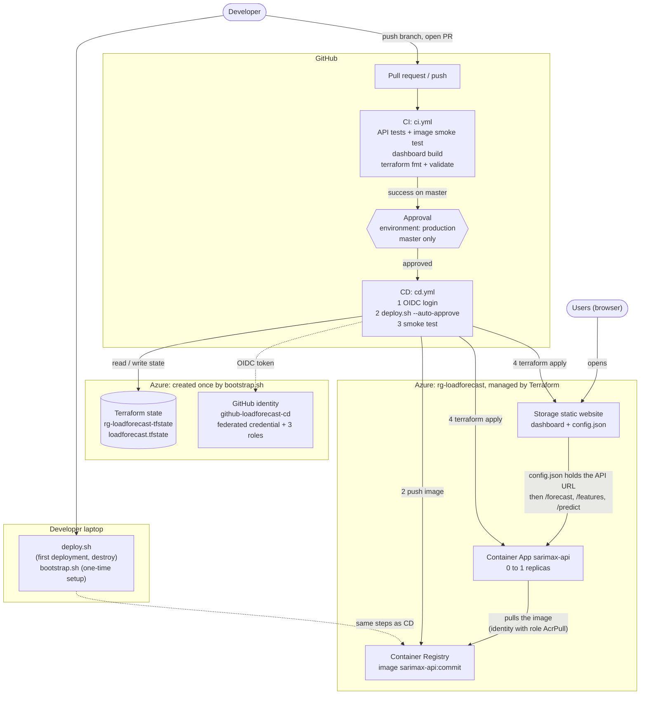
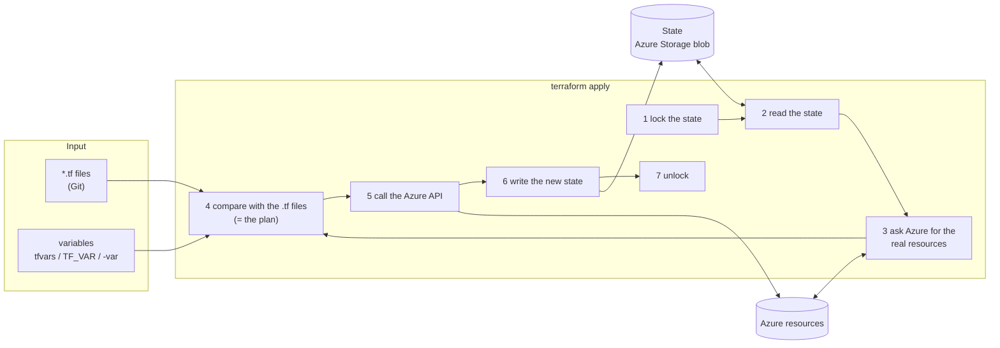
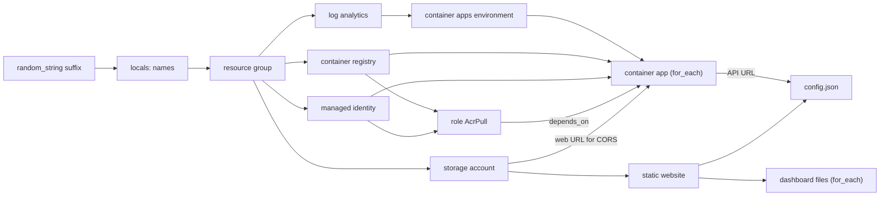
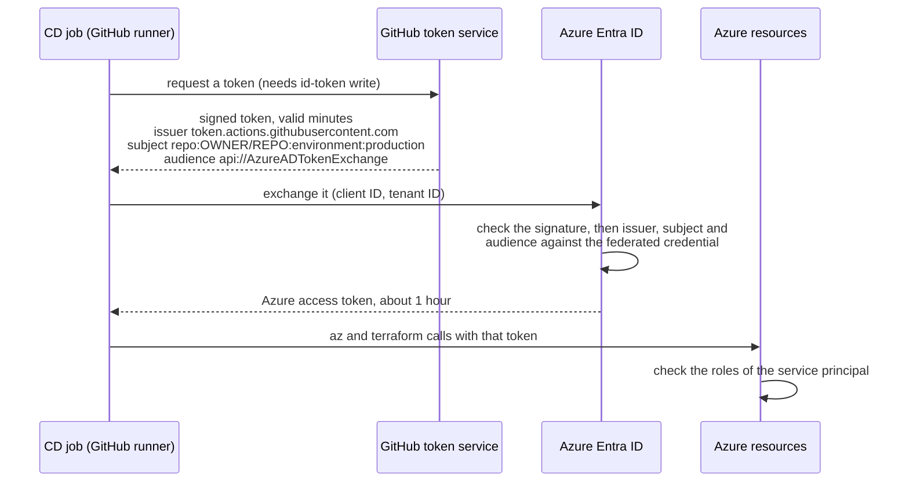

# Deployment architecture

How the SARIMAX API and the what-if dashboard get from this repository to Azure, and what every deployment file
does. Links point to the file and the lines that a section describes (written against commit `2058f96`; if a file
has changed since, the lines may have moved, the section names stay).

The API contract that every model service has to follow is in [API.md](API.md).

**Status (2026-11-14).** The deployment was run once by hand with `deploy.sh`; the dashboard and the API are
live. The CD workflow and `bootstrap.sh` are written but have **not run yet**: CD only starts once `cd.yml` is on
`master`, and `bootstrap.sh` repeats the commands that were first run by hand (against the existing resources it
should change nothing).

## Contents

1. [What is deployed](#1-what-is-deployed)
2. [Overview](#2-overview)
3. [Order of use](#3-order-of-use)
4. [Walkthrough by file](#4-walkthrough-by-file)
5. [Concepts](#5-concepts)
6. [Common tasks](#6-common-tasks)
7. [Decisions and limits](#7-decisions-and-limits)

## 1. What is deployed

| Part | Azure service | Notes |
|---|---|---|
| SARIMAX API (daily, 1 day ahead) | Container Apps (serverless, scales to zero) | https://sarimax-api.whitefield-d7f6fd7f.swedencentral.azurecontainerapps.io |
| Docker images | Container Registry (Basic) | the only fixed cost, about 5 USD per month |
| Dashboard (React + TypeScript) | Storage account, static website | https://loadforecastvllqbweb.z1.web.core.windows.net/ |
| Terraform state | Storage account in its own resource group | shared by laptops and GitHub Actions |
| All of the above in one region | `swedencentral` | Azure for Students only allows five regions |

The tree model and the foundation model are not deployed yet (see [Add another model API](#add-another-model-api)).

## 2. Overview

**Figure 1.** From a commit to Azure: who triggers what, and which Azure resources exist.



Three questions, three tools:

| Question | Answered by | Files |
|---|---|---|
| **What** runs? | Docker: one image with the code, the model and the data | [Dockerfile](../../deploy/sarimax_api/Dockerfile), [stage.sh](../../deploy/sarimax_api/stage.sh) |
| **Where** does it run, and what else exists? | Terraform: declares the cloud resources | [deploy/terraform/](../../deploy/terraform/) |
| **When** and **by whom**? | `deploy.sh` (the steps), CI/CD (automatic trigger, checks, approval) | [deploy.sh](../../deploy/deploy.sh), [.github/workflows/](../../.github/workflows/) |

Terraform does not build the image. `deploy.sh` builds and pushes it, then tells Terraform which tag to run.

## 3. Order of use

| Step | Command | Done by | What it creates |
|---|---|---|---|
| 1 | `deploy/bootstrap.sh state` | an Owner, once per subscription | resource providers, storage for the Terraform state |
| 2 | `deploy/deploy.sh` | from a laptop, once | `rg-loadforecast` and everything in it |
| 3 | `deploy/bootstrap.sh github` | an Owner, once | identity for GitHub Actions, its roles, the `production` environment and variables |
| 4 | merge to `master` | everyone, from then on | CI, approval, CD deploys |

Steps 1 and 3 are the "bootstrap": they cannot be done by Terraform or CD because those need them to exist first
(Terraform needs a place for its state, CD needs an Azure identity). Step 2 comes before 3 because the identity's
roles are scoped to `rg-loadforecast`, which the first deployment creates.

## 4. Walkthrough by file

### 4.1 `deploy/bootstrap.sh`

[bootstrap.sh](../../deploy/bootstrap.sh) runs with `state` or `github`. Every step checks whether its object
already exists, so running it again changes nothing.

| Lines | Section | What it does |
|---|---|---|
| [2–21](../../deploy/bootstrap.sh#L2-L21) | Header | Why a bootstrap exists (chicken and egg), the order for a new subscription |
| [27–46](../../deploy/bootstrap.sh#L27-L46) | Settings | Names and IDs, each overridable by an environment variable. `STATE_ACCOUNT` must equal `storage_account_name` in [versions.tf](../../deploy/terraform/versions.tf#L21-L27) |
| [51–72](../../deploy/bootstrap.sh#L51-L72) | Helpers | `log` / `ok` print progress; `az` hides Python warnings; `ensure_role` assigns a role only if it is not there yet |
| [80–87](../../deploy/bootstrap.sh#L80-L87) | **1.1** Resource providers | A subscription must register a service (e.g. `Microsoft.App` for Container Apps) once before using it. Free, needs rights on the whole subscription, so it is not done by Terraform |
| [89–120](../../deploy/bootstrap.sh#L89-L120) | **1.2** State storage | Own resource group (so destroying the app cannot delete its state); storage account with public blob access off; **blob versioning** (a broken state can be rolled back); a data role for you (Terraform logs in with Azure AD, not with a storage key); the `tfstate` container, retried because a new role takes a minute to apply |
| [129–133](../../deploy/bootstrap.sh#L129-L133) | Phase 2 checks | Stops if `rg-loadforecast` does not exist: run `deploy.sh` first |
| [135–149](../../deploy/bootstrap.sh#L135-L149) | **2.1** Identity | An app registration and its service principal (`github-loadforecast-cd`). No password or secret |
| [151–167](../../deploy/bootstrap.sh#L151-L167) | **2.2** Federated credential | Tells Azure which GitHub token to accept: issuer GitHub, subject `repo:<repo>:environment:production`, audience `api://AzureADTokenExchange` (see [OIDC](#oidc-login-without-a-password)) |
| [169–178](../../deploy/bootstrap.sh#L169-L178) | **2.3** Roles | The three roles below. Nothing on the whole subscription |
| [180–201](../../deploy/bootstrap.sh#L180-L201) | **2.4** GitHub | The `production` environment with you as required reviewer ([L184–190](../../deploy/bootstrap.sh#L184-L190)), deployments only from `master` ([L191–195](../../deploy/bootstrap.sh#L191-L195)), and three variables ([L197–201](../../deploy/bootstrap.sh#L197-L201)) that name the identity to log in as. They are IDs, not secrets |
| [206–213](../../deploy/bootstrap.sh#L206-L213) | Dispatcher | `state` or `github`, otherwise the usage message |

Roles of the GitHub identity ([L169–178](../../deploy/bootstrap.sh#L169-L178)):

| Role | Scope | Why |
|---|---|---|
| Contributor | `rg-loadforecast` | create, change and delete the app's resources |
| Role Based Access Control Administrator, **only for the AcrPull role** (a condition) | `rg-loadforecast` | Terraform gives the API its [AcrPull role](../../deploy/terraform/main.tf#L47-L51); the condition stops the identity from making itself or others Owner |
| Storage Blob Data Contributor | the state storage account | read and write the Terraform state |

### 4.2 `deploy/deploy.sh`

[deploy.sh](../../deploy/deploy.sh) is the **single definition of the deployment steps**. You run it by hand;
[cd.yml](../../.github/workflows/cd.yml#L70-L73) runs the same script.

| Lines | Section | What it does |
|---|---|---|
| [2–18](../../deploy/deploy.sh#L2-L18) | Header | Three ways to run it, what it needs, the four steps |
| [23–36](../../deploy/deploy.sh#L23-L36) | Arguments | none: Terraform shows each plan and asks. `--auto-approve`: no questions (CD, the approval was given in GitHub). `destroy`: delete all resources (asks first) |
| [38–39](../../deploy/deploy.sh#L38-L39) | `terraform init` | Connect to the state in Azure Storage, download the providers |
| [41–45](../../deploy/deploy.sh#L41-L45) | Image tag | The short commit hash; with uncommitted changes a timestamp is added, so a local test build never overwrites the image of a commit |
| [47–50](../../deploy/deploy.sh#L47-L50) | **Step 1** Registry | `terraform apply -target=...container_registry.main`: only the registry (and what it needs). The Container App needs an image to exist, the image needs a registry to go to, so the registry comes first. `-target` is used on purpose here, for ordering |
| [52–56](../../deploy/deploy.sh#L52-L56) | **Step 2** Image | [stage.sh](../../deploy/sarimax_api/stage.sh) copies model, data and code into the build context; `az acr login`; `docker buildx build --platform linux/amd64 --push` (Container Apps run on amd64, also when you build on an Apple-silicon Mac) |
| [58–59](../../deploy/deploy.sh#L58-L59) | **Step 3** Dashboard | `npm ci` and `npm run build` into `deploy/dashboard/dist` (includes the TypeScript check) |
| [61–62](../../deploy/deploy.sh#L61-L62) | **Step 4** Everything else | `terraform apply` with the new tag: the Container App runs the new image, the changed dashboard files are uploaded, `config.json` is written |
| [64–65](../../deploy/deploy.sh#L64-L65) | Outputs | The URLs |

### 4.3 `deploy/terraform/variables.tf`

[variables.tf](../../deploy/terraform/variables.tf): the inputs, read elsewhere as `var.<name>`. A value comes from
(lowest to highest priority): the `default`, `terraform.tfvars`, an environment variable `TF_VAR_<name>`, `-var` on
the command line.

| Lines | Variable | Default | Given by | Purpose |
|---|---|---|---|---|
| [3–6](../../deploy/terraform/variables.tf#L3-L6) | `subscription_id` | none (required) | laptop: `terraform.tfvars`; CD: `TF_VAR_subscription_id` | Which Azure subscription |
| [8–12](../../deploy/terraform/variables.tf#L8-L12) | `location` | `swedencentral` | default | Region (limited by the student policy) |
| [14–18](../../deploy/terraform/variables.tf#L14-L18) | `project` | `loadforecast` | default | Prefix of all resource names |
| [20–32](../../deploy/terraform/variables.tf#L20-L32) | `apps` | one entry, `sarimax-api` | default | A map of **one entry per model API**: image name, port, CPU, memory. [main.tf](../../deploy/terraform/main.tf#L83) creates one Container App per entry with `for_each` |
| [34–37](../../deploy/terraform/variables.tf#L34-L37) | `image_tag` | none (required) | `deploy.sh` with `-var` | Which image version runs. No default on purpose: forgetting it is an error, not a silent deployment of an unknown version |
| [39–43](../../deploy/terraform/variables.tf#L39-L43) | `min_replicas` | `0` | default | 0: scales to zero when idle (free, but the first request waits for the container to start). 1: always on, about 15–20 USD more per month |
| [45–49](../../deploy/terraform/variables.tf#L45-L49) | `dashboard_dist` | `../dashboard/dist` | default | Folder of the built dashboard |

### 4.4 `deploy/terraform/versions.tf`

[versions.tf](../../deploy/terraform/versions.tf): settings for Terraform itself. This is what `terraform init` reads.

| Lines | Section | What it does |
|---|---|---|
| [4](../../deploy/terraform/versions.tf#L4) | `required_version` | Terraform 1.9 or newer |
| [6–15](../../deploy/terraform/versions.tf#L6-L15) | `required_providers` | A provider is the plugin that translates Terraform into a cloud API. `azurerm` (all Azure resources, `~> 5.13`: 5.13 up to, not including, 6.0) and `random` (the name suffix, no cloud). The exact versions are pinned in `.terraform.lock.hcl`, which is committed |
| [17–27](../../deploy/terraform/versions.tf#L17-L27) | `backend "azurerm"` | **Where the state is stored**: the `tfstate` container made by [bootstrap.sh](../../deploy/bootstrap.sh#L89-L120). `use_azuread_auth` logs in with the Azure AD identity (`az login` on a laptop, OIDC in CD), no storage keys. A backend cannot use variables, so the values are literals |
| [30–36](../../deploy/terraform/versions.tf#L30-L36) | `provider "azurerm"` | `features {}` is required, even if empty. `subscription_id` is the first use of a variable. The resource providers are registered by bootstrap, not here |

### 4.5 `deploy/terraform/main.tf`

[main.tf](../../deploy/terraform/main.tf): the registry, the identity and the Container Apps. Terraform builds the
order from the references (`azurerm_resource_group.main.name` means "after the resource group"), see
[Figure 3](#terraform-resource-dependencies).

| Lines | Resource | What it does |
|---|---|---|
| [7–18](../../deploy/terraform/main.tf#L7-L18) | `random_string`, `locals` | A 5-character suffix, because registry and storage names must be unique in all of Azure. `locals` are constants of this configuration: `name` (with hyphen), `flat` (without, for names that forbid hyphens), `tags`. The suffix is created once and kept in the state |
| [20–24](../../deploy/terraform/main.tf#L20-L24) | Resource group | `rg-loadforecast`. A separate group from `ai_deployment_wally`, so `destroy` removes exactly this project |
| [30–37](../../deploy/terraform/main.tf#L30-L37) | Container Registry | Basic. `admin_enabled = false`: no shared password, only Azure identities may pull |
| [40–51](../../deploy/terraform/main.tf#L40-L51) | Identity and role | A user-assigned managed identity, and the role `AcrPull` on the registry for it. Together: "this identity may pull images", no secret |
| [57–64](../../deploy/terraform/main.tf#L57-L64) | Log Analytics | Stores the container logs, 30 days |
| [66–79](../../deploy/terraform/main.tf#L66-L79) | Container Apps environment | The shared runtime of all apps. The `Consumption` workload profile (pay per use) is declared because Azure adds it anyway, and a plan would otherwise show a difference every time |
| [82–141](../../deploy/terraform/main.tf#L82-L141) | Container App (`for_each`) | One per entry of `var.apps`, see below |

The Container App ([L82–141](../../deploy/terraform/main.tf#L82-L141)):

| Lines | Block | What it does |
|---|---|---|
| [92–100](../../deploy/terraform/main.tf#L92-L100) | `identity`, `registry` | Attach the managed identity and pull from the registry with it |
| [102–110](../../deploy/terraform/main.tf#L102-L110) | `ingress` | A public HTTPS URL; `target_port` is the port uvicorn listens on; 100 % of the traffic to the latest revision |
| [113–114](../../deploy/terraform/main.tf#L113-L114) | `min_replicas`, `max_replicas` | 0 to 1 instances |
| [116–123](../../deploy/terraform/main.tf#L116-L123) | Scale rule | Start from zero on HTTP requests; back to zero after 5 minutes without any |
| [125–129](../../deploy/terraform/main.tf#L125-L129) | `container` | The image is `<registry>/<name>:<image_tag>`. **A new tag is how a new version is deployed**: Terraform sees the image change and creates a new revision |
| [131–135](../../deploy/terraform/main.tf#L131-L135) | `env` | `ALLOWED_ORIGINS` is the dashboard URL: the API answers browsers only for the dashboard (CORS) |
| [139–140](../../deploy/terraform/main.tf#L139-L140) | `depends_on` | The AcrPull role must exist first. Terraform cannot see this dependency in any attribute, so it is stated |

### 4.6 `deploy/terraform/dashboard.tf`

[dashboard.tf](../../deploy/terraform/dashboard.tf): the dashboard is plain HTML, JavaScript and CSS, so it lives
in a storage account with the static website feature (a public URL for the special `$web` container). Azure Static
Web Apps would be the dedicated service, but it is only offered in Central US, East US 2, West US 2, West Europe
and East Asia, none of which the student policy allows.

| Lines | Resource | What it does |
|---|---|---|
| [4–12](../../deploy/terraform/dashboard.tf#L4-L12) | Storage account | `substr(..., 0, 24)` keeps the name within Azure's 24-character limit; `LRS` is the cheapest replication |
| [14–18](../../deploy/terraform/dashboard.tf#L14-L18) | Static website | Turns the feature on, which creates the `$web` container. Unknown pages return `index.html` |
| [20–40](../../deploy/terraform/dashboard.tf#L20-L40) | `locals` | `dashboard_origin` ([L21](../../deploy/terraform/dashboard.tf#L21), used for the API's CORS), `web_container_id` ([L22–23](../../deploy/terraform/dashboard.tf#L22-L23), built by hand because Azure creates the container), `dashboard_files` ([L25–26](../../deploy/terraform/dashboard.tf#L25-L26), every built file except `config.json`), `content_types` ([L28–39](../../deploy/terraform/dashboard.tf#L28-L39), so that browsers treat `.js` as JavaScript and `.css` as styles) |
| [42–53](../../deploy/terraform/dashboard.tf#L42-L53) | Dashboard files | One blob per built file (`for_each`). `content_md5` ([L49](../../deploy/terraform/dashboard.tf#L49)) is the file's hash: a changed file is uploaded again, an unchanged one is left alone |
| [55–69](../../deploy/terraform/dashboard.tf#L55-L69) | `config.json` | **Written by Terraform, not copied from `dist/`**: the model list with the URL of the deployed API (`fqdn` of the Container App). That is why `config.json` is excluded in L26: the one in `dist/` points to `localhost:8000` for local development |

The two directions of dependency do not form a loop: the Container App needs only the storage account's URL
(for CORS), and `config.json` needs the Container App's URL: storage account → Container App → `config.json`.

### 4.7 `deploy/terraform/outputs.tf`

[outputs.tf](../../deploy/terraform/outputs.tf): the values printed after `apply`, read with
`terraform output -raw <name>`.

| Lines | Output | Used by |
|---|---|---|
| [3–5](../../deploy/terraform/outputs.tf#L3-L5) | `dashboard_url` | people; [cd.yml](../../.github/workflows/cd.yml#L75-L87) |
| [7–9](../../deploy/terraform/outputs.tf#L7-L9) | `api_urls` | one URL per app, built with a `for` expression; cd.yml |
| [11–17](../../deploy/terraform/outputs.tf#L11-L17) | `acr_login_server`, `acr_name` | [deploy.sh](../../deploy/deploy.sh#L49-L50): where to push the image |
| [19–21](../../deploy/terraform/outputs.tf#L19-L21) | `resource_group` | reference |

### 4.8 `.github/workflows/ci.yml`

[ci.yml](../../.github/workflows/ci.yml): checks that the code works. No Azure access. A workflow has `on` (the
trigger) and `jobs` (run in parallel, each on a fresh virtual machine); a job has `steps` that run in order, with
`uses:` (a ready-made action) or `run:` (a shell command).

| Lines | Section | What it does |
|---|---|---|
| [5–23](../../.github/workflows/ci.yml#L5-L23) | Trigger | Push to `master`, pull requests, or by hand. A `paths` filter: only changes in `deploy/`, `common.py`, `features.py`, the **model JSON** and `data_daily.csv` start it. A new model file therefore starts CI, and after it CD |
| [26–53](../../.github/workflows/ci.yml#L26-L53) | Job `sarimax-api` | pytest ([L35–39](../../.github/workflows/ci.yml#L35-L39), only the API's requirements, `--no-project`); build the image without pushing ([L41–44](../../.github/workflows/ci.yml#L41-L44)); start the container and call `/health`, `/features`, `/predict` ([L46–53](../../.github/workflows/ci.yml#L46-L53)): tests show the Python code is right, the smoke test shows the packaged image is |
| [55–71](../../.github/workflows/ci.yml#L55-L71) | Job `dashboard` | `npm ci` (exactly the versions of `package-lock.json`) and `npm run build` (includes the TypeScript check) |
| [73–86](../../.github/workflows/ci.yml#L73-L86) | Job `terraform` | `fmt -check`, `init -backend=false` (does not connect to Azure), `validate` |

### 4.9 `.github/workflows/cd.yml`

[cd.yml](../../.github/workflows/cd.yml): deploys to Azure. Three gates: only CI runs on `master`, only if CI
succeeded, and then it waits for the approval of the `production` environment.

| Lines | Section | What it does |
|---|---|---|
| [1–11](../../.github/workflows/cd.yml#L1-L11) | Header | What the workflow does and which identity it uses |
| [13–18](../../.github/workflows/cd.yml#L13-L18) | Trigger | `workflow_run`: when the workflow `CI` has completed on `master` (a pull request's CI does not count, its branch is not `master`); or by hand |
| [20–22](../../.github/workflows/cd.yml#L20-L22) | `permissions` | `id-token: write` lets the job request an OIDC token (off by default) |
| [24–26](../../.github/workflows/cd.yml#L24-L26) | `concurrency` | One deployment at a time, never two applies on the same state; a running deployment is not cancelled, because an `apply` stopped halfway is dangerous |
| [28–35](../../.github/workflows/cd.yml#L28-L35) | Job | `if` ([L31](../../.github/workflows/cd.yml#L31)): CI must have succeeded. `environment: production` ([L33–35](../../.github/workflows/cd.yml#L33-L35)): **waits for the approval**, and the OIDC subject becomes `...:environment:production` |
| [36–43](../../.github/workflows/cd.yml#L36-L43) | `env` | `ARM_*` and `ARM_USE_OIDC`: how Terraform (provider and state backend) logs in; `TF_VAR_subscription_id` fills the variable of [variables.tf](../../deploy/terraform/variables.tf#L3-L6). Values come from the environment's variables, no secrets |
| [48–51](../../.github/workflows/cd.yml#L48-L51) | Checkout | The **commit that CI tested** (`workflow_run.head_sha`), not the latest `master`: something merged between CI and the approval is not deployed untested |
| [53–58](../../.github/workflows/cd.yml#L53-L58) | `azure/login` | OIDC login for the `az` CLI (`az acr login` needs it) |
| [60–68](../../.github/workflows/cd.yml#L60-L68) | Tools | Terraform (without the wrapper, so `terraform output -raw` is plain text) and Node |
| [70–73](../../.github/workflows/cd.yml#L70-L73) | **Deploy** | `deploy/deploy.sh --auto-approve`: the same script as on a laptop |
| [75–87](../../.github/workflows/cd.yml#L75-L87) | URLs | Reads the Terraform outputs, writes them to the run summary and to the environment URL |
| [89–95](../../.github/workflows/cd.yml#L89-L95) | Smoke test | Calls the live API and `config.json`, with retries because the API may start from zero |

### 4.10 Other files of the pipeline

| File | What it does |
|---|---|
| [sarimax_api/Dockerfile](../../deploy/sarimax_api/Dockerfile) | `python:3.13-slim`, installs [requirements.txt](../../deploy/sarimax_api/requirements.txt), copies the app and `artifacts/`, starts uvicorn on `$PORT` |
| [sarimax_api/stage.sh](../../deploy/sarimax_api/stage.sh) | Copies `common.py`, `features.py`, the model JSON and `data_daily.csv` into `artifacts/` (git-ignored): the Docker build context must be inside the folder |
| [sarimax_api/app.py](../../deploy/sarimax_api/app.py), [service.py](../../deploy/sarimax_api/service.py) | The FastAPI endpoints and the model logic; the contract is in [API.md](API.md) |
| [dashboard/public/config.json](../../deploy/dashboard/public/config.json) | The model list for local development; in production Terraform writes it ([dashboard.tf](../../deploy/terraform/dashboard.tf#L55-L69)) |

## 5. Concepts

### Terraform in one picture

Terraform is declarative: the `.tf` files say what should exist, not which steps to take. It compares three things:
what the files want, what the **state** says it created, and what Azure really has.

**Figure 2.** What `terraform apply` does (`plan` stops after step 4).



`terraform init` runs before and does only two things: download the providers and connect to the state backend. It
does **not** read variables (that is why a backend cannot use them).

### Terraform resource dependencies

**Figure 3.** The creation order is not written anywhere: Terraform derives it from the references between
resources (an arrow means "needs").



### What lives where

| Thing | Is | Lives in | Why |
|---|---|---|---|
| `*.tf` files | what the cloud should look like | **Git** | code: reviewed and versioned |
| `.terraform.lock.hcl` | the exact provider versions | **Git** | everybody and CI use the same versions |
| **State** | what was really created (IDs, attributes) | **Azure Storage** (blob, versioned) | changes with every apply; must be a single copy with a lock; may hold sensitive values |
| `.terraform/` | downloaded providers (about 200 MB) | local, git-ignored | `terraform init` recreates it |
| `terraform.tfvars` | your subscription ID | local, git-ignored | personal; CD uses `TF_VAR_subscription_id` |

The state's storage account is the one thing Terraform cannot create for itself, which is why it comes from
[bootstrap.sh](../../deploy/bootstrap.sh#L89-L120).

### OIDC login without a password

The classic way is a stored client secret: long-lived, a leak is dangerous, it has to be rotated. With OpenID
Connect, **Azure trusts a short-lived token that GitHub signs**, and nothing secret is stored.

**Figure 4.** The login of the CD job.



What makes it safe:

- The **federated credential** ([bootstrap.sh 2.2](../../deploy/bootstrap.sh#L151-L167)) accepts exactly one subject:
  this repository's `production` environment. Other repositories, forks and branches cannot log in.
- That environment requires **your approval** and allows only **`master`**
  ([bootstrap.sh 2.4](../../deploy/bootstrap.sh#L180-L201)).
- The identity can do **little** ([bootstrap.sh 2.3](../../deploy/bootstrap.sh#L169-L178)): its own resource group
  and the state, nothing on the subscription.
- The three GitHub variables are IDs, not secrets.

## 6. Common tasks

**First deployment on a new subscription**

```bash
az login
deploy/bootstrap.sh state        # providers + state storage
# set subscription_id in deploy/terraform/terraform.tfvars (see terraform.tfvars.example)
deploy/deploy.sh                 # asks before each apply
gh auth login                    # once
deploy/bootstrap.sh github       # GitHub identity and environment
```

If the state storage account name is taken, change `STATE_ACCOUNT` (and `storage_account_name` in
[versions.tf](../../deploy/terraform/versions.tf#L21-L27)).

**Normal change.** Open a pull request: CI runs. After the merge to `master`, CI runs again; when it succeeds, CD
waits for the approval in the GitHub Actions page, then deploys. A new
`src/results/sarimax/models/sarimax_daily_1d.json` is such a change.

**Deploy a branch before merging, or without GitHub.** `deploy/deploy.sh` from the laptop (CD only deploys `master`).

**Delete everything of the app.** `deploy/deploy.sh destroy` removes `rg-loadforecast` and what is in it. The state
storage is in another resource group and stays.

**Look at the API logs.** `az containerapp logs show -n sarimax-api -g rg-loadforecast --tail 50`

<a id="add-another-model-api"></a>
**Add another model API (tree model, foundation model).** A new Container App is one more entry in `var.apps`, but
three more places have to know about it:

| Where | Change |
|---|---|
| [variables.tf](../../deploy/terraform/variables.tf#L29-L31) | a new entry in `apps` (image name, port, CPU, memory) |
| [deploy.sh](../../deploy/deploy.sh#L52-L56) | build and push its image (today only `sarimax-api`) |
| [dashboard.tf](../../deploy/terraform/dashboard.tf#L61-L66) | add it to the model list of `config.json` (today a single hard-coded entry) |
| [ci.yml](../../.github/workflows/ci.yml#L26-L53) | tests and smoke test for its folder |

The service itself has to follow the [API contract](API.md). A model that is only a forecast file (the foundation
model) needs no API: put the CSV in `deploy/dashboard/public/` and list it with `forecastCsv` in the dashboard's
config (see [API.md](API.md#dashboard-config)).

## 7. Decisions and limits

| Decision | Reason |
|---|---|
| Region `swedencentral` | The student policy only allows `swedencentral`, `norwayeast`, `belgiumcentral`, `polandcentral` and `switzerlandnorth` |
| Dashboard in a storage account | Static Web Apps is not offered in those regions (see [4.6](#46-deployterraformdashboardtf)) |
| Container Apps, scale to zero | Almost free for a demo; the price is a wait for the first request after idle time. `min_replicas = 1` removes it |
| Maximum one replica | The API keeps no state and a demo needs no scaling; it also bounds the cost |
| Image tag = commit | Every version is traceable, and a rollback is a deployment of an older tag |
| Managed identity for the registry | No registry password anywhere (`admin_enabled = false`) |
| OIDC for GitHub | No stored Azure secret |
| State in Azure Storage with versioning | One copy for laptops and CD, a lock against two applies, old versions to roll back |
| Bootstrap by script, not Terraform | The state storage and the CD identity must exist before Terraform and CD can run |
| What-if only for the models with an API | A model deployed as an API can recompute; a forecast file cannot |

Known limits: the API loads the model and the data when it starts (a few seconds); the what-if forecast of the
SARIMAX API is linear in the X by construction (see [API.md](API.md#sarimax-notes)); CD has not run yet.
